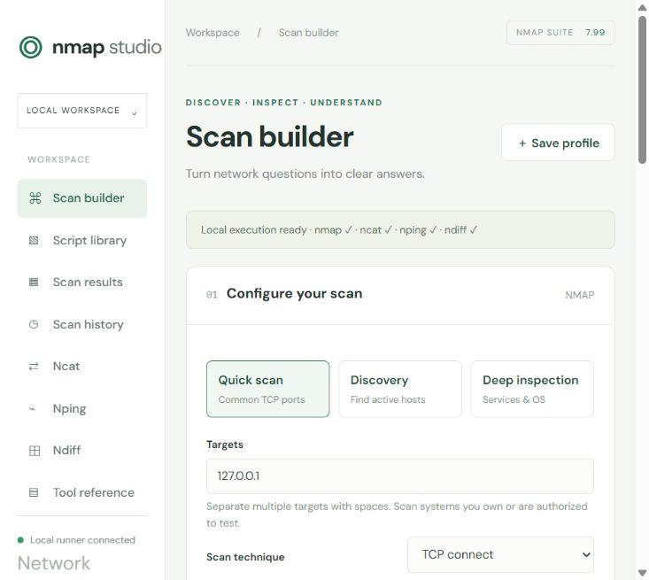

# Nmap Studio

Nmap Studio is a local browser interface for Nmap, Ncat, Nping, and Ndiff. It turns common network tasks into forms, shows live output, and converts Nmap XML into a host and service inventory.

> Use Nmap Studio only on systems you own or have explicit permission to test.

## Highlights

- Run all four Nmap suite tools inside the UI.
- Normalize website URLs to hostnames before scanning.
- Stream output, send process input, cancel a process tree, and stop the runner.
- Parse every completed Nmap scan into structured results automatically.
- Discover the installed Nmap version, NSE scripts, executable paths, and CLI help.
- Start in Safe mode with a server-side option allowlist. Advanced mode requires explicit confirmation.
- Save reusable profiles and import/export them as JSON.
- Keep scan history off by default; enable it locally or clear it at any time.
- Download rotating diagnostic logs from Settings.
- Use a dependency-free Python server on Windows, macOS, or Linux.

## Install and run

Requirements:

- Python 3.10 or newer
- The [official Nmap suite](https://nmap.org/download.html), with its executables on PATH

Clone or download this repository, then run:

~~~bash
python server.py
~~~

The app opens at http://127.0.0.1:8765. Keep the terminal open and press Ctrl+C to stop it. On Windows, double-click start.cmd; use stop.cmd or Settings → Stop local runner when finished.

Set NMAP_STUDIO_PORT before starting if port 8765 is already in use.

## Execution modes

Safe mode accepts common scan, discovery, timing, service, OS, connection, and probe options. It rejects custom scripts, script arguments, listeners, output path overrides, and uncommon raw options.

Turn off Safe mode to use the complete installed command line. The UI asks for confirmation and the server also requires an explicit advanced-mode flag. Commands are created as argument arrays and launched without a shell, so shell operators and expansion are never evaluated.

Raw packet scans, OS detection, and some probe modes may need administrator or root privileges. Start with ordinary user permissions and elevate only for a task that requires it.

## Privacy and data

The runner binds only to loopback. It validates Host and Origin, requires a random session token, sends no CORS headers, applies a strict Content Security Policy, limits requests and output, and retains at most 20 completed jobs for 24 hours in memory.

Nmap Studio does not send scan data to a hosted service. Browser history persistence is disabled by default. Profiles and enabled history are stored in the browser. Reports and rotating diagnostic logs are stored under .nmap-studio/, which Git ignores.

Imported XML is limited to 10 MB, 2,000 hosts, and 50,000 ports. Automatic report parsing rejects XML document types.

## Development

Run the checks with:

~~~bash
python -m unittest discover -s tests -v
python -m py_compile server.py launch.py
node --check dist/app.js
~~~

Build the release archive and checksum with:

~~~bash
python scripts/build_release.py
~~~

See [CONTRIBUTING.md](CONTRIBUTING.md) for the contribution workflow and [SECURITY.md](SECURITY.md) for private vulnerability reporting.

## Project scope

Nmap Studio is an independent interface and is not an official Nmap project. Nmap and its related tools remain subject to their own license; see [THIRD_PARTY_NOTICES.md](THIRD_PARTY_NOTICES.md) and [NMAP-LICENSE.txt](NMAP-LICENSE.txt). Nmap Studio's original code is released under the [MIT License](LICENSE).
