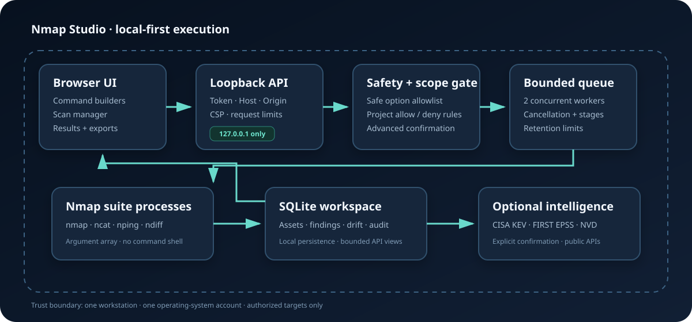

# Architecture

Nmap Studio is deliberately local-first. The browser interface and Python runner share the loopback boundary; scan processes inherit only the permissions of the account that started the runner.

## Request flow

1. The browser builds a command as an argument array, never as a shell string.
2. The runner validates the session token, Host, Origin, request size, tool, and arguments.
3. Safe mode applies an option allowlist and checks NSE scripts against installed metadata. Advanced mode requires an explicit browser confirmation and API flag.
4. The queue permits two running jobs and keeps additional jobs bounded.
5. The runner launches the selected Nmap suite executable without a command shell.
6. Output, progress, and parsed Nmap XML are retained in memory within fixed limits and returned to the local browser.
7. Completed Nmap reports update the SQLite asset/service inventory, finding workflow, drift alerts, and audit chain.

## Trust boundaries

- **Browser storage:** profiles and optional history stay in the browser. History is off by default.
- **Loopback API:** the server binds to `127.0.0.1`, rejects untrusted Host and Origin values, requires a random session token for mutations, and emits a restrictive Content Security Policy.
- **Process boundary:** arguments are passed as an array with `shell=False`. Process cancellation terminates the process tree where the operating system supports it.
- **Filesystem:** reports, the SQLite workspace, and rotating diagnostics are local under `.nmap-studio/`; Git ignores that directory.
- **Scheduler:** schedules run only while the local process is open. Every invocation is revalidated in Safe mode and against current scope rules.
- **Network:** Nmap traffic goes directly from the local process to targets selected by the operator. Nmap Studio has no hosted scan service. Only an explicitly confirmed intelligence refresh contacts CISA, FIRST, and NVD.

## Main modules

| Module | Responsibility |
| --- | --- |
| `server.py` | Local HTTP API, validation, job queue, process lifecycle, XML parsing, diagnostics |
| `workspace.py` | SQLite inventory, drift, findings, schedules, scope, audit chain, and integration exports |
| `intelligence.py` | Bounded, explicitly triggered CISA KEV, FIRST EPSS, and NVD enrichment |
| `dist/app.js` | UI state, tool builders, scan manager, results dashboard, NSE library |
| `dist/core.js` | Pure result filtering, comparison, and export functions |
| `dist/catalog.js` | Human-readable tool and script descriptions |
| `tests/` | API security, lifecycle, workspace, audit, scope, comparison, and export tests |

## Persistence and integrity

SQLite uses foreign keys and WAL mode. Each API operation opens a short-lived connection and closes it explicitly. Audit entries include the previous entry hash; the governance screen recomputes the chain so direct modification is detectable. This is tamper-evident, not tamper-proof: a local administrator can replace the entire database.

Service inventory represents the latest scan that touched an asset. Services not observed in a later scan remain available for history but are marked `not-seen`; drift alerts capture the change.

## Limits

This architecture reduces accidental command injection and unsafe defaults; it does not make an unauthorized scan acceptable or remove the risks of powerful Nmap options. Do not expose the runner through a reverse proxy, port forward, or public host.
